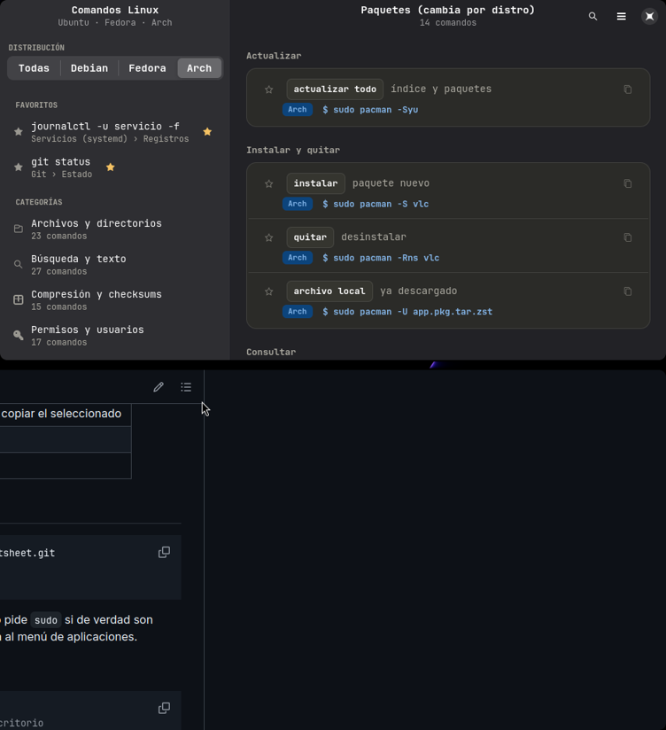
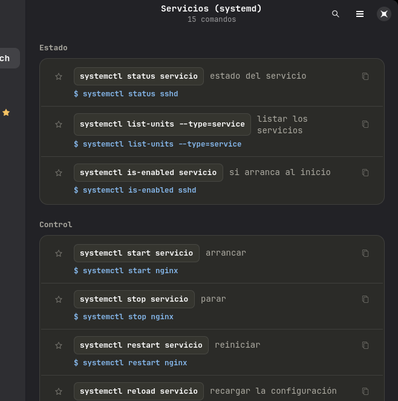
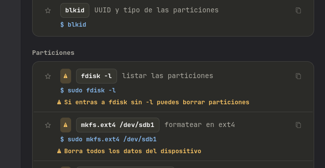
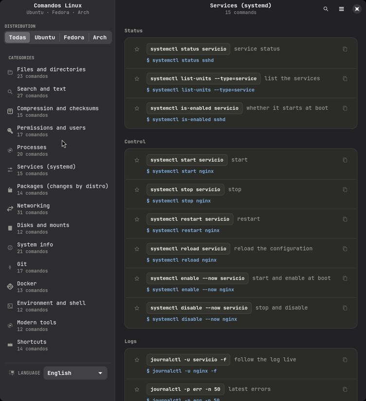

<div align="center">

# Comandos Linux

**Chuleta de comandos para Ubuntu, Fedora y Arch — en una app de escritorio que funciona sin internet.**



</div>

---

## ¿Qué es?

Una aplicación de escritorio nativa (GTK4 + libadwaita) con **263 comandos** Linux
organizados en **15 categorías**. Los comandos que cambian entre
distribuciones (instalar paquetes, activar servicios, cortafuegos…)
muestran la variante de **Ubuntu**, **Fedora** o **Arch** y tú eliges cuál ver.

- **100 % offline** — no hace ni una sola petición de red.
- **Barra lateral** con las categorías, iconos y contador de comandos.
- **Búsqueda instantánea** por comando, descripción o ejemplo, con resultados planos.
- **Favoritos ⭐**: marca los comandos que usas a diario y quedan guardados.
- **Copiar al portapapeles** con un clic (en el comando o en su ejemplo).
- **⚠️ Avisos en los comandos destructivos**, para no copiarlos a ciegas.
- **Modo oscuro/claro automático**, siguiendo el tema del sistema.
- Los mismos datos se pueden exportar a **HTML** (standalone) y a **Markdown**.

## 📚 Qué incluye

| Categoría | Comandos | Categoría | Comandos |
|---|---:|---|---:|
| 📁 Archivos y directorios | 23 | 💽 Discos y montajes | 12 |
| 🔍 Búsqueda y texto | 27 | ℹ️ Info del sistema | 21 |
| 📦 Compresión y checksums | 15 | 🌿 Git | 17 |
| 🔒 Permisos y usuarios | 17 | 🐳 Docker | 13 |
| ⚙️ Procesos | 20 | 💻 Entorno y shell | 12 |
| 🛠️ Servicios (systemd) | 15 | 🧰 Herramientas modernas | 12 |
| 📥 Paquetes | 14 | ⌨️ Atajos | 14 |
| 🌐 Redes | 31 | **Total** | **263** |

### Servicios del sistema



### Comandos destructivos, con aviso



## 🧭 Familias de distribuciones, no distribuciones

De los 263 comandos, **234 son idénticos** en cualquier Linux y solo **29 cambian**
según el gestor de paquetes. Por eso la app no pregunta "¿Ubuntu, Fedora o Arch?",
sino **¿de qué familia es tu sistema?**:

| Familia | Gestor | Sirve también a |
|---|---|---|
| **Debian/Ubuntu** | `apt`, `dpkg`, `ufw` | Debian, Mint, Pop!_OS, Zorin, elementary, Kali |
| **Fedora/RHEL** | `dnf`, `firewall-cmd` | RHEL, Rocky, Alma, CentOS Stream, Nobara |
| **Arch** | `pacman`, `nft` | Manjaro, EndeavourOS, SteamOS, CachyOS |

**Y la detecta sola**: al abrir la app se lee `/etc/os-release` (`ID` e
`ID_LIKE`) y se selecciona tu familia automáticamente. Si prefieres verla
siempre, el menú ☰ tiene **«Detectar mi distro»** para volver al modo
automático.

El selector sigue mostrando 4 botones cortos (`Todas │ Debian │ Fedora │
Arch`) para que quepan en la barra lateral; el nombre completo va en el tooltip.

## 🌍 Dos idiomas

La app está **en español e inglés**: no solo los botones, también las
descripciones, los ejemplos, los avisos y los nombres de las categorías.
El selector está **al pie de la barra lateral** y la preferencia se recuerda
al cerrar la app.



En inglés, la búsqueda también busca en inglés: escribe `permissions` y
encuentra `chmod`, `chown`… aunque el comando esté en español.

El HTML exportado lleva su propio selector de idioma y acepta el parámetro
`?lang=en` (o `#lang=en`) para abrirlo directamente en inglés.

## ✨ Funciones

| | |
|---|---|
| 🧭 Barra lateral | Categorías con icono y nº de comandos, favoritos arriba y filtro de distro |
| 🖧 Autodetección | Detecta tu familia de distro al abrir y selecciona sus comandos |
| 🔍 Buscar | Escribe arriba; la vista cambia a resultados planos con su categoría |
| ⭐ Favoritos | Estrella en cada comando; se guardan entre sesiones |
| 📋 Copiar | Clic en el comando o en el ejemplo; el portapapeles se actualiza solo |
| ⚠️ Avisos | Los comandos destructivos se marcan con un aviso en ámbar |
| 🌍 Idiomas | Español e inglés, conmutable al instante y sin reiniciar |
| ⌨️ Atajos | `Ctrl+K` buscar · `Ctrl+1..9` ir a la categoría N · `Ctrl+C` copiar el seleccionado |
| 📤 Exportar | A HTML autocontenido o a Markdown, desde el menú ☰ |
| 🌓 Tema | Claro/oscuro automático según el sistema |

## 📦 Instalación

```bash
git clone https://github.com/angelherman0130-cell/linux-commands-cheatsheet.git
cd linux-commands-cheatsheet
./install.sh
```

El instalador detecta tu distribución, instala las dependencias que falten
(solo pide `sudo` si de verdad son necesarias), deja el comando
`comandos-linux` en el `PATH` y añade la entrada al menú de aplicaciones.

### Opciones del instalador

```bash
./install.sh                 # instalación normal
./install.sh --escritorio    # además crea el acceso directo en el Escritorio
./install.sh --sin-deps      # no toca dependencias del sistema
```

> **¿No aparece en el menú?** Algunos lanzadores (como el Spotlight de Omarchy)
> solo leen las entradas `.desktop` al arrancar. Cierra sesión y vuelve a
> entrar, o reinicia el shell, y aparecerá. El comando `comandos-linux`
> funciona siempre.

### Dependencias

| Distribución | Paquetes |
|---|---|
| Arch / Omarchy / Manjaro | `python-gobject gtk4 libadwaita` |
| Ubuntu / Debian / Mint | `python3-gi gir1.2-gtk-4.0 gir1.2-adw-1` |
| Fedora / RHEL / Nobara | `python3-gobject gtk4 libadwaita` |

Si las dependencias no se pueden instalar, la app **no se rompe**: cae
automáticamente al modo HTML y abre la chuleta en el navegador.

### Desinstalar

```bash
./uninstall.sh
```

### Acceso directo

En Linux el equivalente al acceso directo de Windows es la **entrada del
menú de aplicaciones**: se instala en `~/.local/share/applications/` y
aparece en cualquier launcher (Spotlight, menú de Omarchy, GNOME, KDE…).
Si tu escritorio muestra iconos en el escritorio, `./install.sh --escritorio`
deja además un icono en `~/Desktop/` listo para doble clic.

## 🚀 Uso

```bash
comandos-linux              # abre la app
comandos-linux --listar     # lista las categorías en la terminal
comandos-linux --export-html comandos-linux.html
comandos-linux --export-md comandos-linux.md
comandos-linux --export-md comandos-linux-en.md --idioma en
comandos-linux --version
```

También puedes abrirla desde el menú de aplicaciones como **«Comandos Linux»**.

### Atajos de teclado

| Atajo | Acción |
|---|---|
| `Ctrl+K` / `Ctrl+F` | Enfocar el buscador |
| `Esc` | Limpiar la búsqueda / cerrar el buscador |
| `Ctrl+1` … `Ctrl+9` | Ir a la categoría N |
| `Ctrl+C` | Copiar el resultado seleccionado |

## ✏️ Añadir o corregir comandos

Todos los datos viven en **un solo archivo**:

```
src/comandos_linux/datos/comandos.json
```

```jsonc
{
  "nombre": "Redes",
  "icono": "network-transmit-receive-symbolic",   // icono del sistema
  "slug": "redes",                                 // identificador interno
  "grupos": [
    {
      "nombre": "Instalar si falta",
      "comandos": [
        { "cmd": "dig", "desc": "consultas DNS", "ejemplo": "dig example.com" },

        // Si cambia según la familia, usa "variantes":
        { "cmd": "wget", "desc": "descargas", "variantes": {
          "d": "sudo apt install wget",      // Debian / Ubuntu
          "f": "sudo dnf install wget",      // Fedora / RHEL
          "a": "sudo pacman -S wget"         // Arch
        }},

        // Si es destructivo, añade "peligro" y la app lo marcará con un aviso:
        { "cmd": "rm -rf dir", "desc": "recursivo y forzado",
          "ejemplo": "rm -rf build/",
          "peligro": "Borra todo el contenido sin preguntar" }
      ]
    }
  ]
}
```

- `cmd` → el comando (monoespaciado).
- `desc` → descripción corta.
- `ejemplo` → ejemplo de uso. Si empieza por `#` se muestra como comentario.
- `variantes` → en lugar de `ejemplo` cuando el comando difiere por familia
  (`d` = Debian/Ubuntu, `f` = Fedora/RHEL, `a` = Arch).
- `peligro` → texto de aviso para los comandos destructivos (opcional).
- `icono` → cualquier icono del tema del sistema (`folder-symbolic`,
  `network-server-symbolic`, `edit-find-symbolic`…).

Guarda el archivo, reinicia la app y listo: la app, el HTML y el Markdown se
generan siempre desde esta misma fuente.

## 🗂️ Estructura

```
linux-commands-cheatsheet/
├── install.sh / uninstall.sh     # instalación en el usuario
├── pyproject.toml                # metadatos (permite pip install .)
├── src/comandos_linux/
│   ├── __main__.py               # CLI: --export-html, --export-md, --idioma, --listar
│   ├── app.py                    # ventana: barra lateral + panel de contenido
│   ├── vistas.py                 # constructores de widgets (filas, tarjetas, chips)
│   ├── i18n.py                   # carga de traducciones y aplicación al dataset
│   ├── i18n/en.json              # ← las traducciones al inglés
│   ├── prefs.py                  # favoritos, idioma y preferencias persistentes
│   ├── datos.py                  # carga, búsqueda y filtrado
│   ├── exportar.py               # exportadores HTML y Markdown
│   ├── estilo.css                # paleta y estilos
│   └── datos/comandos.json       # ← el dataset (fuente única, en español)
├── assets/
│   ├── desktop/comandos-linux.desktop
│   └── iconos/comandos-linux.svg
└── docs/                         # capturas para el README
```

Los favoritos y la última categoría visitada se guardan en
`~/.config/linux-commands-cheatsheet/estado.json` (se crea solo).

### Traducir a otro idioma

El español es el idioma base y vive en `datos/comandos.json`. Para añadir un
tercer idioma:

1. Copia `src/comandos_linux/i18n/en.json` como `i18n/fr.json` y traduce sus
   apartados (`meta`, `ui`, `categorias`, `grupos`, `comandos`, `ejemplos`,
   `peligros`).
2. Registra el idioma en `i18n.py`:

```python
IDIOMAS = {"es": "Español", "en": "English", "fr": "Français"}
```

3. Añade el nombre a `HTML_BASE` para el HTML exportado.

Las traducciones se indexan **por el texto original**, así que basta con
traducir cada frase una vez aunque aparezca en varios comandos.

## 🛠️ Desarrollo

```bash
git clone https://github.com/angelherman0130-cell/linux-commands-cheatsheet.git
cd linux-commands-cheatsheet
PYTHONPATH=src python3 -m comandos_linux          # ejecutar sin instalar
PYTHONPATH=src python3 -m comandos_linux --export-md /tmp/prueba.md
```

Para una instalación de desarrollo también vale:

```bash
pip install -e .      # instala el comando `comandos-linux` en modo editable
```

---

## English summary

**Comandos Linux** is a native desktop app (GTK4 + libadwaita) that works
completely offline. It bundles **263 Linux commands in 15 categories** for
Ubuntu, Fedora and Arch — including the distro-specific variants (package
managers, service activation, firewalls, network tools). The sidebar lists
every category with its icon and command count, and a favourites section keeps
the commands you use most at hand. Live search shows flat results with the
category of each match, one click copies any command or example, destructive
commands are flagged with a warning, and the whole cheat sheet can be exported
to a standalone HTML file or to Markdown.

Because only 29 of the 263 commands actually change between distributions, the
app works with **distribution families** (Debian/Ubuntu, Fedora/RHEL, Arch)
instead of exact distros, and it **detects yours automatically** by reading
`/etc/os-release` — so the right commands are already selected when you open it.

The interface and every description ship in **Spanish and English**, switchable
from the sidebar — and the choice is remembered between sessions. Search works
in the selected language too, so typing `permissions` in English finds
`chmod` and `chown`.

The dataset lives in a single JSON file, so adding or fixing a command is a
one-line edit — the app, the HTML export and the Markdown export are all
generated from it.

## 📄 Licencia

MIT — ver [LICENSE](LICENSE).
